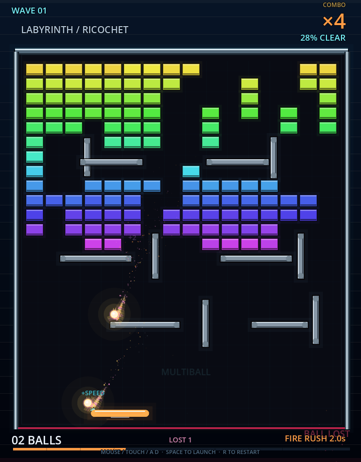
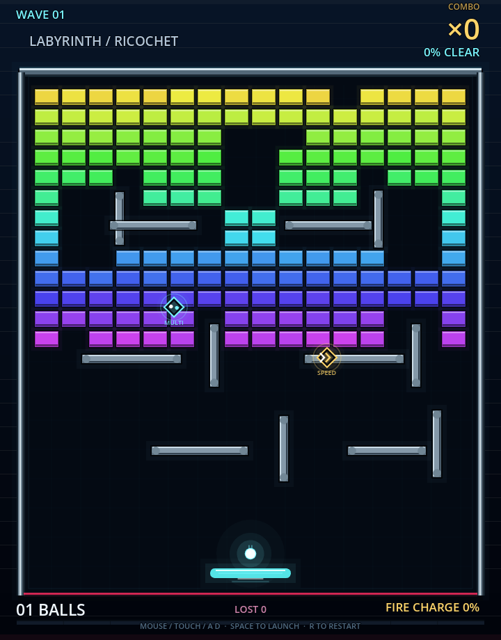

# Ricochet Labyrinth

一个使用 Godot 4.7 制作的霓虹竖屏打砖块 / 迷宫弹球游戏。视觉和音效均为程序化生成，不依赖外部美术、字体或音频素材。

## 运行

用 Godot 4.7+ 打开本目录，运行主场景：

```powershell
godot --path .
```

## 操作

- 鼠标 / 触屏左右拖动：移动挡板
- `A` / `D` 或方向键：移动挡板
- 鼠标左键 / 触屏点击 / `Space` / `Enter`：发射球
- `R`：重新开始
- 球漏出底部会损失一颗球；底部计数是当前球数，`LOST` 是累计丢失数

## 玩法

- 程序化迷宫砖块关卡与波次切换
- 连击倍率、多球、动态清除百分比
- `MULTI` 道具：所有小球翻倍，上限 24 颗
- `SPEED` 道具：所有小球速度提升 18%，上限 980
- 道具默认 14% 掉落率，连续 8 次未掉落触发保底
- `FIRE RUSH`：命中充能，满能量后进入 6 秒穿透冲刺
- 自定义圆形 / AABB 碰撞、固定物理步模拟
- 霓虹拖尾、粒子、屏幕震动、漂浮文字与程序化音效

## 项目结构

```text
main.tscn                       # 唯一主场景
resources/
├── game_config.tres            # 游戏数值、当前关卡与道具目录
├── levels/labyrinth.tres       # 关卡布局
└── powerups/                  # 道具定义
scripts/
├── main.gd                     # 组合根，只连接各模块
├── core/                      # 世界状态、事件、输入、碰撞几何
├── systems/                   # 碰撞与关卡生成
├── model/                     # 类型化球、砖块、道具实体
├── data/                      # 配置及道具效果接口
└── presentation/              # 绘制、HUD、音效、粒子
```

核心 `GameWorld` 不依赖场景节点、绘制或音频，可以独立进行 headless 测试。玩法和视觉使用不同随机源，渲染帧数不会改变关卡或掉落结果。

详细设计和扩展方法见 [`docs/implementation.md`](docs/implementation.md)。

## 测试

```powershell
godot --headless --path . --script res://tests/powerup_test.gd
godot --headless --path . --script res://tests/world_test.gd
godot --headless --path . --script res://tests/scene_smoke_test.gd
```

也可以运行全部测试：

```powershell
powershell -ExecutionPolicy Bypass -File tools/run_tests.ps1 -Godot godot
```

## 预览




